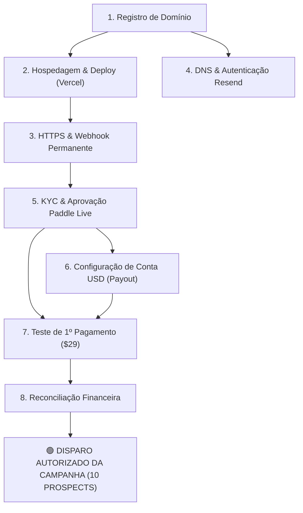

# PRODUCTION ACTIVATION & COMMERCIAL LAUNCH RUNBOOK — M7

**Document ID:** `COMM-DOC-016`  
**Reference:** M7 Controlled Commercial Launch Preparation  
**Target:** First Commercial Deployment, Live Payments & Controlled Outreach  
**Policy Compliance:** Purely Operational Plan (**NO ACTIONS EXECUTED YET — ZERO EXPENDITURE**)

---

## 1. VISÃO GERAL DO PROCESSO DE LANÇAMENTO

Este runbook define a sequência operacional precisa para transformar a versão homologada do BidReady em uma operação comercial em produção, com recebimento de pagamentos em dólares e disparo seguro das abordagens comerciais.

---

## 2. SEQUÊNCIA OPERACIONAL DAS 8 ETAPAS

---

### ETAPA 1: Registro de Domínio Comercial Próprio
- **Objetivo:** Adquirir um domínio corporativo de primeiro nível (.com, .io ou .ai) para estabelecer identidade profissional e permitir configuração de e-mails transacionais e webhooks HTTPS.
- **Procedimento:**
  1. Acessar registrar confiável (Cloudflare Registrar, Namecheap ou Porkbun).
  2. Buscar disponibilidade de domínios sugeridos: `bidready.ai`, `bidready.io`, `getbidready.com` ou `bidreadyapp.com`.
  3. Efetuar o registro com proteção de privacidade WHOIS ativada.
  4. Habilitar gerenciamento de DNS no provedor escolhido (ou apontar os Name Servers para a Cloudflare).
- **Custo Estimado:** ~US$ 10,00 a US$ 14,00 / ano (~R$ 55 a R$ 75 — único custo inicial obrigatório).
- **Responsável:** Proprietário do Projeto.
- **Dependências:** Nenhuma.
- **Evidência de Conclusão:** Domínio ativo no registrar e painel de controle de DNS acessível com registros NS propagados.

---

### ETAPA 2: Hospedagem e Publicação em Produção (Vercel)
- **Objetivo:** Publicar a aplicação Next.js Turbopack em infraestrutura de borda global com suporte a Serverless Functions.
- **Procedimento:**
  1. Conectar a conta Vercel ao repositório GitHub do projeto (`QUOTEFLOW`).
  2. Adicionar o domínio customizado registrado na Etapa 1 nas configurações de domínio da Vercel.
  3. Configurar os registros DNS no provedor (CNAME `cname.vercel-dns.com` para subdomínio e registro A para apex).
  4. Configurar as variáveis de ambiente essenciais de produção na Vercel:
     - `NEXT_PUBLIC_APP_URL` (ex: `https://bidready.io`)
     - `NODE_ENV=production`
     - `NEXT_PUBLIC_SUPABASE_URL` e `NEXT_PUBLIC_SUPABASE_ANON_KEY`
     - `SUPABASE_SERVICE_ROLE_KEY`
     - `AI_DEFAULT_PROVIDER=gemini`
     - `GEMINI_API_KEY` e `GEMINI_MODEL=gemini-2.5-flash`
     - `BILLING_MAINTENANCE_MODE=false`
  5. Aplicar localmente e executar a migration `20261111000008_email_outbox.sql` no Supabase remoto para habilitar a tabela de outbox persistente.
  6. Disparar o primeiro deploy de produção na Vercel e verificar compilação sem erros.
- **Custo Estimado:** US$ 0,00 (Plano Hobby durante teste piloto inicial) ou US$ 20,00/mês (Vercel Pro para operação comercial plena).
- **Responsável:** Engenharia / Proprietário.
- **Dependências:** Etapa 1 (Domínio registrado).
- **Evidência de Conclusão:** URL de produção pública respondendo com status HTTP 200 na Landing Page (`https://bidready.io`) e compilação limpa de todas as 24 rotas.

---

### ETAPA 3: HTTPS e Endpoint Permanente do Webhook
- **Objetivo:** Garantir certificado SSL/TLS automático e estabelecer a URL imutável de recebimento de notificações de pagamento.
- **Procedimento:**
  1. Confirmar emissão automática do certificado TLS/SSL pela Vercel/Cloudflare (cadeia válida e redirecionamento HTTP -> HTTPS forçado).
  2. Definir a rota canônica do webhook de faturamento: `https://[SEU-DOMINIO]/api/billing/webhook`.
  3. Realizar requisição HTTP POST de teste com cabeçalho inválido para testar resposta imediata de segurança HTTP 400 (`Missing signature`).
- **Custo Estimado:** US$ 0,00 (Certificado Let's Encrypt / Vercel SSL incluso).
- **Responsável:** Engenharia.
- **Dependências:** Etapa 2 (Deploy com domínio ativo).
- **Evidência de Conclusão:** Requisição `curl -k https://[SEU-DOMINIO]/api/billing/webhook` retorna erro 400 de assinatura esperada e certificado TLS A+ no SSL Labs.

---

### ETAPA 4: Configuração de DNS e Autenticação no Resend
- **Objetivo:** Autenticar o domínio próprio no Resend para disparo de e-mails transacionais em produção sem cair em caixas de spam.
- **Procedimento:**
  1. Criar conta no Resend ([resend.com](https://resend.com)).
  2. Adicionar o domínio registrado na aba "Domains".
  3. Obter os registros DNS gerados pelo Resend:
     - 1 registro TXT para SPF (`v=spf1 include:amazonses.com ~all`).
     - 2 registros CNAME/TXT para DKIM (assinatura criptográfica de chave pública).
     - 1 registro TXT para DMARC (`v=DMARC1; p=none; rua=mailto:...`).
  4. Inserir os registros no painel de controle DNS do domínio e aguardar propagação.
  5. Clicar em "Verify Domain" no Resend e confirmar status "Verified".
  6. Gerar a chave de API de produção (`re_...`) e configurar nas variáveis da Vercel:
     - `RESEND_API_KEY=re_...`
     - `EMAIL_FROM=BidReady <notifications@bidready.io>`
     - `RESEND_MOCK_MODE=false` (ou omitir)
- **Custo Estimado:** US$ 0,00 (Plano gratuito do Resend inclui até 3.000 e-mails/mês e 100 e-mails/dia).
- **Responsável:** Proprietário / Engenharia.
- **Dependências:** Etapa 1 (Domínio) e Etapa 2 (Variáveis na Vercel).
- **Evidência de Conclusão:** Domínio marcado como "Verified" no dashboard do Resend e teste de envio de e-mail de boas-vindas recebido na caixa de entrada sem alerta de spam.

---

### ETAPA 5: KYC e Aprovação da Conta Paddle Live
- **Objetivo:** Ativar a conta da Paddle como Merchant of Record (MoR) em modo Live para processamento de pagamentos reais em USD.
- **Procedimento:**
  1. Acessar o painel da Paddle ([paddle.com](https://www.paddle.com)) e alternar de "Sandbox" para "Live".
  2. Preencher o formulário de ativação de negócios (KYC):
     - Razão Social e CNPJ da empresa brasileira.
     - Documento de constituição societária (Contrato Social / Certidão Simplificada da Junta Comercial).
     - Documento de identidade do responsável legal (Passaporte ou CNH).
     - Endereço físico comercial no Brasil.
     - URL oficial do site publicado na Etapa 2 (com termos de uso e política de privacidade em inglês já presentes no app).
  3. Aguardar aprovação cadastral da equipe de compliance da Paddle (geralmente de 24 a 72 horas úteis).
  4. Após aprovação, cadastrar no painel Live os 3 produtos com faturamento mensal:
     - **Starter Tier:** US$ 29 / mês -> Copiar o Price ID (`pri_...`).
     - **Pro Tier:** US$ 69 / mês -> Copiar o Price ID (`pri_...`).
     - **Business Tier:** US$ 149 / mês -> Copiar o Price ID (`pri_...`).
  5. Configurar o Webhook de Produção no painel da Paddle:
     - URL: `https://[SEU-DOMINIO]/api/billing/webhook`.
     - Eventos inscritos: `subscription.created`, `subscription.updated`, `subscription.canceled`, `subscription.past_due`, `transaction.completed`.
     - Copiar a chave secreta gerada (`pdl_ntfset_...`).
  6. Atualizar as variáveis de ambiente na Vercel:
     - `PADDLE_ENV=production`
     - `PADDLE_API_KEY=paddlegb_...` (Chave Live gerada)
     - `PADDLE_WEBHOOK_SECRET=pdl_ntfset_...` (Secret Live do webhook)
     - `NEXT_PUBLIC_PADDLE_CLIENT_TOKEN=live_...`
     - `PADDLE_PRICE_STARTER=pri_...` (ID Live de $29)
     - `PADDLE_PRICE_PRO=pri_...` (ID Live de $69)
     - `PADDLE_PRICE_BUSINESS=pri_...` (ID Live de $149)
- **Custo Estimado:** US$ 0,00 de setup (taxa exclusivamente variável de 5% + US$ 0,50 por transação paga).
- **Responsável:** Proprietário do Projeto (titular da empresa).
- **Dependências:** Etapa 2 (Site no ar) e Etapa 3 (Webhook HTTPS).
- **Evidência de Conclusão:** Conta Live aprovada na Paddle, webhook Live ativo e Price IDs reais de produção salvos na Vercel.

---

### ETAPA 6: Configuração da Conta Bancária para Recebimento (Payout em USD)
- **Objetivo:** Cadastrar uma conta bancária corporativa em dólares (USD) vinculada à empresa para receber as transferências periódicas da Paddle.
- **Procedimento:**
  1. Utilizar ou abrir conta Global PJ internacional em instituição autorizada para empresas brasileiras:
     - **Inter Global PJ:** Conta corrente em USD nos EUA para PJ brasileira, sem taxa de abertura.
     - **Husky / Nomad PJ:** Recebimento direto em USD com spread reduzido.
     - **Remessa Online PJ / Wise Business:** Dados bancários nos EUA (Routing Number ACH e Account Number).
  2. No painel da Paddle (Payout Settings):
     - Selecionar moeda de repasse: USD.
     - Método de Payout: Wire Transfer / ACH Transfer.
     - Inserir Nome da Empresa, Routing Number e Account Number.
     - Definir frequência de repasse (semanal ou mensal com piso mínimo, ex: US$ 100).
- **Custo Estimado:** US$ 0,00 de abertura/manutenção (taxas de câmbio são cobradas somente na conversão USD -> BRL, tipicamente entre 1% e 1,5%).
- **Responsável:** Proprietário do Projeto.
- **Dependências:** Conta bancária PJ ativa em nome da empresa.
- **Evidência de Conclusão:** Status de "Payout Method Verified" no painel da Paddle.

---

### ETAPA 7: Teste do Primeiro Pagamento Real e Primeiro Repasse
- **Objetivo:** Validar o ciclo financeiro real antes de divulgar para prospects externos.
- **Procedimento:**
  1. Acessar a aplicação em produção e criar uma conta de teste do proprietário.
  2. Ir até `/pricing` e assinar o plano **Starter ($29/mês)** usando um cartão de crédito real do proprietário.
  3. Confirmar se o checkout da Paddle processa a transação real em dólares.
  4. Confirmar que o webhook de produção da Paddle disparou com sucesso, foi validado e atualizou a organização na tabela `saas_subscriptions` para `plan_id = starter` e franquia mensal de 10 análises.
  5. Confirmar recebimento do e-mail de confirmação da transação pelo Resend.
  6. No painel da Paddle, verificar se o valor líquido (após dedução da taxa da Paddle) foi creditado no saldo de payout.
- **Custo Estimado:** US$ 29,00 (pago com cartão próprio; o valor líquido retornará para a conta da empresa no próximo payout, resultando em custo real de apenas ~US$ 2,00 de taxa de processamento).
- **Responsável:** Proprietário e Engenharia.
- **Dependências:** Etapas 4, 5 e 6 concluídas.
- **Evidência de Conclusão:** Transação confirmada no extrato do cartão, registro de assinatura ativo no Supabase com limite de 10 análises e saldo disponível na Paddle.

---

### ETAPA 8: Reconciliação Financeira entre Paddle e Banco
- **Objetivo:** Estabelecer a rotina periódica de conciliação entre vendas, faturas, deduções e depósito na conta bancária.
- **Procedimento:**
  1. Baixar o relatório mensal de payout da Paddle (`Payout Breakdown CSV`), contendo:
     - Faturamento Bruto (Gross Revenue).
     - Impostos retidos e recolhidos pela Paddle (US Sales Tax / VAT).
     - Taxas de processamento (MoR fee).
     - Reembolsos ou chargebacks (se houver).
     - Valor Líquido Transferido (Net Payout).
  2. Confrontar o valor líquido com o extrato bancário da conta USD (Inter Global / Husky / Wise).
  3. Emitir a Nota Fiscal de Prestação de Serviços (NFS-e) para o exterior contra a Paddle.com Market Ltd (com isenção de PIS/COFINS para exportação de serviços de software conforme legislação brasileira).
- **Custo Estimado:** US$ 0,00 (processo operacional administrativo).
- **Responsável:** Proprietário / Contabilidade.
- **Dependências:** Etapa 7 (Primeiro payout executado).
- **Evidência de Conclusão:** Planilha de conciliação mensal conferida e saldo conciliado com extrato bancário.

---

## 3. QUADRO RESUMO DE DEPENDÊNCIAS, CUSTOS E PRAZOS

| Etapa | Ação | Responsável | Custo Estimado | Prazo Estimado | Gating / Pré-requisito |
| :---: | :--- | :---: | :---: | :---: | :--- |
| **1** | Registro de Domínio | Proprietário | ~US$ 12 / ano | 15 min | Nenhuma |
| **2** | Deploy Vercel (Produção) | Engenharia | US$ 0 / mês | 30 min | Domínio registrado |
| **3** | HTTPS & Webhook Permanente | Engenharia | US$ 0 | 10 min | Deploy ativo |
| **4** | DNS & Chaves Resend | Engenharia | US$ 0 | 30 min | Domínio registrado |
| **5** | KYC & Aprovação Paddle Live | Proprietário | US$ 0 | 1 a 3 dias | Site no ar com Termos/Privacidade |
| **6** | Dados Bancários USD (Payout) | Proprietário | US$ 0 | 20 min | Conta PJ ativa |
| **7** | Teste de 1º Pagamento ($29) | Proprietário | ~US$ 2 (taxa) | 15 min | Paddle Live aprovado |
| **8** | Reconciliação Financeira | Proprietário | US$ 0 | Recorrente | 1º payout recebido |
| **TOTAL** | **Investimento Inicial Upfront:** | — | **~US$ 12 a US$ 14** | **~2 a 3 dias** | **100% dentro do teto de R$ 500** |

---

## 4. GATILHO DE ATIVAÇÃO DA CAMPANHA (GO-LIVE)

A campanha de prospecção com os 10 alvos qualificados (`commercial/13_first_outreach_campaign.md`) será disparada **exclusivamente após a conclusão da Etapa 7**. 

Isso garante que qualquer prospect que clique no link da mensagem:
1. Navegue em um domínio oficial e seguro (`https://bidready.io`).
2. Tenha acesso à demonstração e ao onboarding automatizado.
3. Consiga assinar o plano Starter (10 análises) ou Pro (40 análises) em modo Live com cobrança real e liberação automática instantânea.
