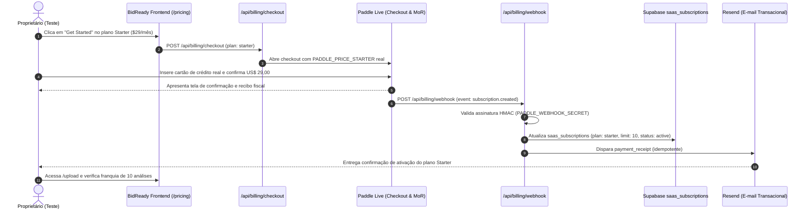

# LAUNCH COST AUDIT & FIRST PAYMENT RECONCILIATION PROCEDURE — M8

**Document ID:** `COMM-DOC-019`  
**Reference:** M8 Paddle Approval & Payout Readiness  
**Target:** Financial Architecture, Unit Economics & Live Payment Test Plan  
**Status:** Verification Completed / Test Protocol Ready  
**Restrictions:** No Real Payments Executed — Zero External Deployments — R$ 500 Budget Preserved

---

## 1. AUDITORIA DETALHADA DE CUSTOS DE LANÇAMENTO

Os custos operacionais foram rigorosamente discriminados entre **Obrigatórios Iniciais (Upfront)**, **Custos Fixos de Escala (Opcionais no Início)** e **Custos Variáveis por Faturamento/Uso**:

```
+-----------------------------------------------------------------------------------------------------------------------------+
| RECURSO / SERVIÇO           | PROVEDOR       | CUSTO ESTIMADO                | CLASSIFICAÇÃO      | JUSTIFICATIVA TÉCNICA   |
+-----------------------------------------------------------------------------------------------------------------------------+
| 1. Domínio Corporativo      | Cloudflare /   | ~US$ 10 a US$ 12 / ano        | OBRIGATÓRIO        | Necessário para HTTPS,  |
|    (.com, .io ou .ai)       | Namecheap      | (~R$ 60,00 pagamento único)   | INICIAL UPFRONT    | e-mails e aprovação MoR |
+-----------------------------------------------------------------------------------------------------------------------------+
| 2. Hospedagem Serverless    | Vercel         | US$ 0,00 (Hobby p/ piloto) ou | OPCIONAL NO INÍCIO | O plano Hobby suporta   |
|                             |                | US$ 20,00 / mês (Pro comercial| (Escala comercial) | as primeiras 10 contas; |
|                             |                | ~R$ 110/mês)                  |                    | migrar para Pro com ARR |
+-----------------------------------------------------------------------------------------------------------------------------+
| 3. Banco de Dados & RLS     | Supabase       | US$ 0,00 (Free Tier) ou       | OPCIONAL NO INÍCIO | O banco atual com RLS   |
|                             |                | US$ 25,00 / mês (Pro prod     | (Escala comercial) | atende o piloto; migrar |
|                             |                | ~R$ 138/mês)                  |                    | para Pro com 10+ clientes|
+-----------------------------------------------------------------------------------------------------------------------------+
| 4. E-mails Transacionais    | Resend         | US$ 0,00                      | OBRIGATÓRIO        | Gratuito até 3.000      |
|                             |                | (Plano Free até 100 e-mails/d)| (CUSTO ZERO)       | mensagens por mês       |
+-----------------------------------------------------------------------------------------------------------------------------+
| 5. Gateway & MoR            | Paddle         | 5% + US$ 0,50 por transação   | VARIÁVEL           | Cobrado exclusivamente  |
|                             |                |                               | SOBRE RECEITA      | no momento da venda     |
+-----------------------------------------------------------------------------------------------------------------------------+
| 6. Processamento IA         | Google Cloud   | ~US$ 0,01 a US$ 0,02 por      | VARIÁVEL           | Menos de US$ 2,00 a cada|
|    (Gemini 2.5 Flash)       |                | edital de 100 páginas         | SOBRE USO          | 100 editais analisados  |
+-----------------------------------------------------------------------------------------------------------------------------+
| 7. Câmbio e Payout          | Payoneer /     | Spread de ~1,5% a 2,0%        | VARIÁVEL           | Descontado apenas no    |
|                             | Banco Central  | + IOF de 0,38%                | SOBRE REPASSE      | momento do resgate BRL  |
+-----------------------------------------------------------------------------------------------------------------------------+
```

### Análise de Impacto sobre o Orçamento Inicial de R$ 500,00:
- **Custo Inicial Obrigatório para Abrir o Lançamento:** Apenas o **registro do domínio próprio** (~R$ 60 a R$ 75).
- **Saldo Restante do Orçamento de R$ 500:** **~R$ 425 a R$ 440 livres.**
- **Preservação de Caixa:** Todos os demais serviços técnicos (Vercel, Supabase, Resend, Paddle) operam com **custo fixo inicial de R$ 0,00**, viabilizando a validação comercial com margem de segurança financeira absoluta.

---

## 2. PROCEDIMENTO DE TESTE DO PRIMEIRO PAGAMENTO CONTROLADO (LIVE)

Este protocolo deverá ser executado **após a aprovação da conta Live pela Paddle**, utilizando uma conta de teste operada pelo próprio proprietário, para validar o ecossistema financeiro e de produto de ponta a ponta:



---

## 3. CHECKLIST PASSO A PASSO DA RECONCILIAÇÃO DO TESTE

### Fase 1: Execução do Pagamento ($29 Starter)
1. **Ambiente:** Acessar o domínio público (`https://[seu-dominio]/signup`) e criar a conta de teste: `test-admin@[seu-dominio].com`.
2. **Checkout:** Navegar até `/pricing` e assinar o plano **Starter ($29/mês)** com cartão de crédito internacional de titularidade do proprietário.
3. **Verificação no Painel Paddle:**
   - Confirmar transação registrada na aba `Transactions` com status `Completed`.
   - Verificar valor bruto: US$ 29,00.
   - Verificar dedução da taxa Paddle: ~US$ 1,95 (5% + $0,50).
   - Verificar saldo líquido creditado: ~US$ 27,05.

### Fase 2: Verificação de Webhook e Banco de Dados (Supabase)
1. **Auditoria da Tabela `billing_webhook_events`:**
   - Confirmar registro do evento com `event_type = 'subscription.created'`.
   - Confirmar `processing_status = 'processed'`.
2. **Auditoria da Tabela `saas_subscriptions`:**
   - `plan_id` atualizado para `'starter'`.
   - `monthly_analyses_limit` atualizado para `10`.
   - `analyses_used_in_period` mantido em `0`.
   - `status` marcado como `'active'`.
   - `current_period_end` registrado para +30 dias.
3. **Auditoria da Tabela `email_outbox_events`:**
   - Confirmar registro do evento `payment_receipt` com chave de idempotência `payment_receipt:sub_...`.
   - Confirmar status `'sent'` e `resend_id` preenchido.
   - Confirmar recebimento do e-mail na caixa de entrada do testador.

### Fase 3: Verificação de Quotas no Produto
1. Realizar o upload de 1 edital de teste em `/upload`.
2. Confirmar que a extração ocorre com sucesso.
3. Confirmar que a franquia é debitada de 10 para 9 análises restantes no dashboard.

### Fase 4: Verificação de Cancelamento e Reembolso (Refund Test)
1. Acessar `/settings` e clicar em **"Manage Subscription"**.
2. No Customer Portal oficial da Paddle, testar o botão de cancelamento.
3. Confirmar que a Paddle emite o evento `subscription.canceled`.
4. No painel da Paddle, emitir o **reembolso integral (Full Refund)** da transação de teste de US$ 29,00 para o cartão do proprietário.
5. Confirmar que a Paddle processa o estorno sem custos residuais adicionais e envia o webhook de atualização correspondente.

### Fase 5: Reconciliação do Saldo Final
- Confirmar que o saldo líquido no painel da Paddle retornou a zero ou ao valor exato das vendas subsequentes.
- Confirmar que o extrato do cartão de crédito estornou os US$ 29,00.
- Registrar a conformidade financeira antes de liberar a abordagem aos 10 prospects.
